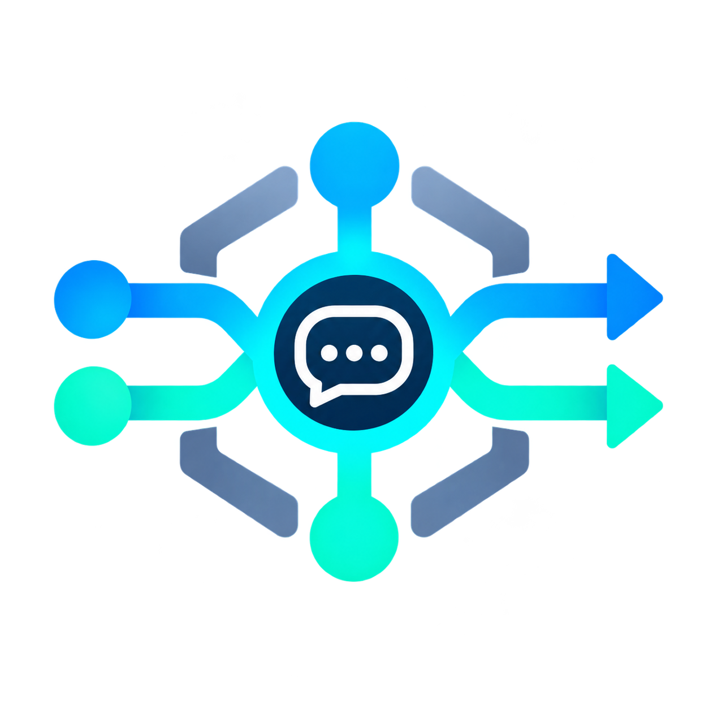
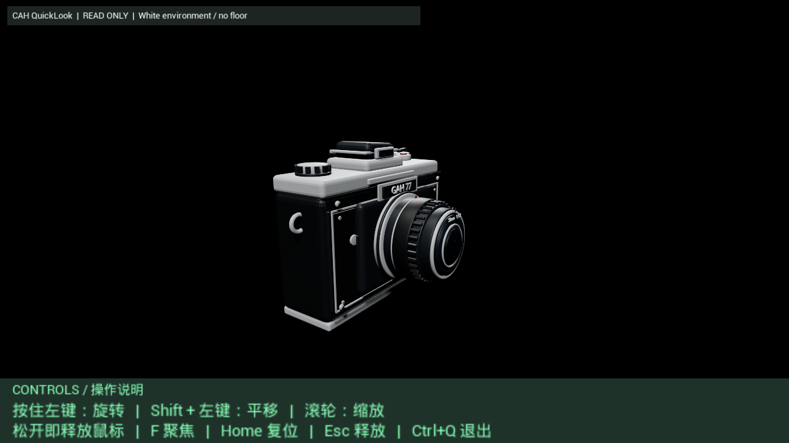

<p align="center"></p>

# Chat Agent Harness (CAH)

**Harness AI with Git.**

Chat Agent Harness is a Git-backed harness for turning ordinary ChatGPT conversations into persistent, tool-using agents that can plan work, execute tasks on a real machine, survive conversation replacement, and continue from durable state.

The basic idea is simple:

```text
ChatGPT  <->  Git  <->  Local Machine
```

ChatGPT handles semantic reasoning. Git holds durable state and coordinates work. Local runners and browser automation connect that state to real programs.

CAH builds the lifecycle, scheduling, recovery, and execution machinery around that connection.

**Support / 赞助：** [Ko-fi](https://ko-fi.com/kou392350) · [Patreon](https://www.patreon.com/cw/Kou848) · [爱发电 / Afdian](https://afdian.com/a/kkt_ifd1) · [支付宝 / Alipay](SPONSOR.md)

---

## Latest release: v1.1.0 — 2026-10-25

CAH v1.1.0 brings updated lifecycle, recovery, scheduling and reusable execution capabilities into the public edition.

| Area | Current behavior |
|---|---|
| Helper | Immediate bounded recovery for reported Harness/Host/Bridge errors, with task-owned diagnosis and exact cleanup. |
| Continuity | Task-scoped Worker generations and retention, Planner Memory, durable Child Reply and checkpointed handoff. |
| Completion | The final Result/Outcome write carries `turn_signal`; Harness reconciles canonical Git and advances the task. |
| Capacity | Two normally online Managed Runners; the second retains `backup`. A separate `cah-shot` Runner handles short tasks and recovery control. |
| Execution | Reusable Managed, Stage 0, capability-probe, action-recovery, Skill-import and Short Task workflows. |
| Skills | Reusable procedures and guides covering asset work, diagnosis, transfer and execution, with personal case material separated. |
| Installation | AI-led deployment, browser-read Project URLs and a configuration tool for each user's installation. |

[Download v1.1.0](https://github.com/Tests4gptplay/chat-agent-harness/releases/tag/v1.1.0) · [Install CAH](installation/README.md) · [Update notes](RELEASE_NOTES.md)

---

## How CAH started

CAH started from a fairly simple technical question.

ChatGPT can already communicate with Git through official integrations and GitHub connectors. Git, in turn, is already a mature part of traditional software development and can reliably trigger or coordinate local programs.

So the question became:

**If GPT ↔ Git works, and Git ↔ local execution works, does GPT ↔ Git ↔ local execution work too?**

The remaining problem was simply how Git should reach a real machine.

The answer turned out to be surprisingly ordinary: **GitHub Actions and a self-hosted Runner already provide a mature solution for that.**

That small experiment worked.

The rest of CAH grew from there.

---

## What CAH does

A normal ChatGPT conversation is temporary. It may become too long, stall, be replaced, or simply be the wrong place to keep machine state.

CAH separates **reasoning context** from **durable task state**.

**Git is canonical.** ChatGPT conversations act as replaceable semantic workers around that state.

A managed task is typically divided into four roles:

```text
                         User
                          |
                          v
                     Foreground
                          |
                          v
                       Planner
                    /           \
                   v             v
               Worker         Worker
                    \         /
                     \       /
                      Helper
              operational recovery
```

### Foreground

The persistent human-facing boundary. It interprets user intent, decides whether work is small enough to execute directly or should become managed work, and presents final results back to the user.

### Planner

Owns task-level reasoning. It decomposes larger work, dispatches bounded Child tasks, reviews Worker results, replans when necessary, and preserves semantic continuity across generations.

### Worker

Executes one bounded piece of work. Workers can use GitHub, browser automation, local programs, scripts, build systems, Blender, Unreal Engine, or other authorized execution surfaces.

Workers are replaceable. Their continuity lives in Git rather than in one conversation.

### Helper

Handles operational incidents. Helper is not another Planner: its job is to diagnose and repair problems such as a stalled browser conversation, blocked Runner, broken execution path, or other lifecycle fault without unnecessarily changing the task's semantic direction.

---

## Git is the source of truth

CAH deliberately does not treat chat text as authoritative machine state.

Important state is written to Git:

```text
Task Contract
Plan
Planner Memory
Worker Child Reply
Result / Outcome
Lane state
Lifecycle state
Evidence references
```

A model response is useful reasoning context. A durable Git write is the record that survives it.

Current semantic completion is governed by the **last durable Git write**, not a second chat or syscall signal:

```text
semantic work and evidence
    |
    v
write bound Reply / Planner Memory
    |
    v
write bound Result / Outcome + turn_signal LAST
    |
    v
Harness reconciles canonical Git and advances the lifecycle
```

No `semantic_sync`, one-word chat ending, or browser response-end is required as completion authority.

This allows a conversation to disappear without taking the task history with it.

---

## Execution paths

CAH currently has two main execution modes.

### Direct bounded work

Small, clear tasks can remain under Foreground ownership. They do not need a Planner/Worker task tree merely because local execution is involved.

A dedicated Short Task Runner can be used for bounded host-side work.

### Managed Task Cell

Larger tasks use the Planner → Worker model.

A managed task can:

- span multiple conversations;
- use multiple Worker lanes;
- hand work across Worker generations;
- preserve Planner continuity;
- continue while external builds, renders, Cooks, or workflows are running;
- recover from physical conversation failures;
- keep task state independent of browser conversation lifetime.

---

## Conversation lifecycle

CAH treats ChatGPT conversations as managed execution resources rather than permanent agents.

Current lifecycle mechanisms include:

- task-owned Worker pools;
- multiple Worker lanes;
- generation and fencing;
- durable handoff state;
- Planner continuity memory;
- Worker Child Reply continuity;
- bounded conversation retention;
- physical conversation replacement;
- watchdog-driven recovery;
- Helper recovery paths;
- deterministic cleanup of task-owned runtime state.

A Worker can therefore finish one generation, preserve its progress, and allow a successor to continue without relying on the previous chat remaining active forever.

---

## Browser and local execution

CAH uses an authenticated browser session as the semantic execution surface and connects it to local infrastructure.

The host side currently includes:

- a native Playwright-based browser host;
- a local Bridge;
- Git-backed control state;
- GitHub Actions;
- self-hosted Runners;
- registered reusable Tools;
- task-local scripts and execution materials.

CAH does not require every task to be implemented as a GitHub Actions workflow. Workflows, local scripts, browser Tools, and other execution providers are selected according to the task.

---

## Tools and Skills

CAH distinguishes reusable **execution capabilities** from reusable **semantic procedures**.

### Tools

Tools are executable capabilities: browser interaction, local command execution, capability probing, or task-specific providers. The Tool Registry defines reusable execution surfaces without embedding their implementation details repeatedly in role prompts.

### Skills

Skills are reusable semantic procedures learned or imported from successful work. A Skill can describe how to approach a recurring class of task while leaving actual execution to the relevant Tool or authorized environment.

The public library includes reusable procedures, guides and source material. Task-specific inputs, personal preferences and private case records stay in each user's installation.

---

## Your CAH installation

Use this public source to configure your own private operational repository. That repository stores your task descriptions, Planner Memory, Worker replies, results and local installation bindings.

```text
Public source -> Configure your repository and paths
              -> Bind ChatGPT Projects and Runner roles
              -> Start CAH and work from the Foreground chat
```

The [Installation guide](installation/README.md) walks the deployment AI through that process.

---

## Optional desktop monitor / 可选桌宠监控

[CAH Sentinel](https://github.com/Tests4gptplay/cah-sentinel) is an optional Windows desktop pet and task-status monitor for **Chat Agent Harness (CAH)**. It reads CAH's already-synchronized local Git snapshot, displays task status and sends desktop notifications. Sentinel does not fetch from GitHub, modify CAH state, or execute tasks; CAH's own local synchronization must remain active. It is a separate companion application, not a required CAH component.

[CAH Sentinel](https://github.com/Tests4gptplay/cah-sentinel) 是 **Chat Agent Harness（CAH）** 的可选 Windows 桌宠式任务状态监控工具：只读查看 CAH 已同步的本地 Git 快照，显示任务状态并发送桌面通知。它不主动 fetch、不修改 CAH 状态，也不代替 CAH 执行任务；仍依赖 CAH 自身的本地同步。它是独立配套工具，不是 CAH 必装组件。

[Download / 下载](https://github.com/Tests4gptplay/cah-sentinel/releases) · [Installation / 安装指引](https://github.com/Tests4gptplay/cah-sentinel/blob/main/docs/INSTALL.zh-CN.md)

## Installation

**[AI-led Installation guide](installation/README.md)**

Give the guide to an AI with Windows command/file access and browser control. It prepares the tools, reads your Project URLs, configures your instance, registers the Runner roles and starts CAH. You handle the login and account authorization prompts.

```text
installation/
    README.md
    CONFIGURATION_MAP.md
    config.example.json
    configure.py
```

The configuration tool creates a new operational copy with your repository, directories, Projects and Foreground conversation. Daily startup uses `Start_CAH.bat`.

---

## Showcases

CAH is intended to be demonstrated through complete end-to-end workloads rather than isolated synthetic commands.

### Viewer/Cook showcase — two parts

[Fresh P1 / Recovery case](showcases/ue-parallel-viewer/README.md) · [中文](showcases/ue-parallel-viewer/README.zh-CN.md) · [Historical Viewer — 2026-09-20](showcases/ue-parallel-viewer/historical-2026-09-20/README.md) · [Evidence](showcases/ue-parallel-viewer/evidence.json)



**Part 1 is the success case:** one long-running managed task split into fresh Cook, a freshly reconstructed Viewer, and integration workstreams, then iterated for more than five hours until real native output passed the acceptance boundary. The historical Viewer was source/design reference only; old binaries, captures, Cook output and PASS labels were not reused as the new result.

The historical Viewer is preserved beside P1 because the implementation path is materially different: the 2026-09-20 case used the installed UE 5.6.1 **Editor runtime in `-game`**, while the fresh P1 run moved to a packaged **`WITH_EDITOR=0` standalone Game runtime** and ultimately a **Pak-only / no-IoStore** Viewer package consuming the real external camera PAK.

The side-by-side cases also show that the later AI run did not mechanically replay the earlier implementation even though that implementation was available as reference. A highly similar Viewer objective produced a materially different runtime architecture.

**Part 2 is the recovery stress test:** this was not a dry run. The same concrete engineering task kept doing real Viewer/Cook/runtime work until a Worker-authored execution wedge finally forced the first human recovery intervention almost ten hours after Parent start.

The stability numbers are the headline:

- **9h58m19s** of real-task operation before the first system-level failure required human operational recovery;
- **17h47m56s** from Parent start through G31 durable handoff, with only **two** human recovery interventions;
- **3h13m12s** of further unattended operation after Helper Hotfix 2.0, with no additional Helper failure before G31.

The first intervention improved recovery infrastructure enough that when G12 later blocked primary execution, G13–G15 still continued on backup capacity. The second intervention upgraded Helper after the post-G15 recovery path failed to close. After that, the same Parent Task continued automatically through G31. G32 later exposed a different physical-page failure class: response-start occurred, but the web conversation stayed busy for more than two hours without producing semantic output.

Part 2 documents **substantial practical stability** under a real engineering workload. CAH v1.1.0 includes [30-minute physical Planner recovery](docs/task-cell/PLANNER.md#physical-planner-watchdog), [same-generation Worker recovery and immediate Helper handling of Harness errors](docs/task-cell/HELPER.md).

More sanitized showcases can be added here as complete end-to-end records become suitable for public release.

---

## Source and downloads

**Current release: [CAH v1.1.0](https://github.com/Tests4gptplay/chat-agent-harness/releases/tag/v1.1.0)** — 2026-10-25.

[Download CAH-1.1.0.zip](https://github.com/Tests4gptplay/chat-agent-harness/releases/download/v1.1.0/CAH-1.1.0.zip) · [SHA-256 checksums](https://github.com/Tests4gptplay/chat-agent-harness/releases/download/v1.1.0/SHA256SUMS) · [Installation guide](installation/README.md)

The versioned source bundle includes the runtime, workflows, reusable Skills and AI-led installation tools. Public `main` carries ongoing source updates. See the [v1.1.0 update notes](RELEASE_NOTES.md).

---

## Repository layout

```text
AGENTS.md
installation/
docs/
    task-cell/
harness/
local_bridge/
playwright_host/
host/
executors/
skills/
state/
tests/
tools/
```

Important entry points:

- [installation/README.md](installation/README.md) — deployment and configuration
- [AGENTS.md](AGENTS.md) — common Agent contract
- [docs/task-cell/README.md](docs/task-cell/README.md) — managed role model
- [docs/task-cell/PLANNER.md](docs/task-cell/PLANNER.md) — Planner contract
- [docs/task-cell/WORKER.md](docs/task-cell/WORKER.md) — Worker contract
- [docs/task-cell/HELPER.md](docs/task-cell/HELPER.md) — Helper contract
- [docs/SCHEDULER_MODEL.md](docs/SCHEDULER_MODEL.md) — scheduling model
- [docs/WORKER_GENERATIONS.md](docs/WORKER_GENERATIONS.md) — conversation ownership and retention
- [docs/TOOL_SYSTEM.md](docs/TOOL_SYSTEM.md) — reusable executable capabilities
- [docs/SKILL_SYSTEM.md](docs/SKILL_SYSTEM.md) — reusable semantic procedures
- [docs/STORAGE_POLICY.md](docs/STORAGE_POLICY.md) — runtime/task storage policy

---

## Design principles

**Git is canonical.** Conversation state alone is not durable authority.

**Conversations are replaceable.** Continuity must survive a chat being retired or replaced.

**Semantic and mechanical work are separate.** Planner/Worker reasoning should not own transport bookkeeping that the Harness can determine mechanically.

**Execution should be task-shaped.** A browser Tool, local script, Runner job, workflow, or dedicated application may all be valid execution surfaces.

**Recovery should preserve semantics when possible.** A physical failure should not automatically create a new semantic direction.

**Private runtime state stays private.** The public source repository is not a live CAH task database.

---

## Requirements

The current maintained reference environment is Windows-based.

A typical installation uses:

- Git;
- Python with the Windows `py` launcher;
- Windows PowerShell and PowerShell 7;
- Node.js 20+ for Playwright tooling;
- Chrome or a compatible configured browser;
- GitHub access;
- GitHub Actions self-hosted Runner(s);
- an authenticated ChatGPT browser session.

Choose and install professional applications such as Blender or Unreal Engine according to the task.

---

## License

Original CAH code and documentation are licensed under the **GNU Affero General Public License v3.0 only (AGPL-3.0-only)**. Earlier MIT-licensed copies keep the rights originally granted under their earlier terms.

See [LICENSE](LICENSE) and [NOTICE](NOTICE).

Third-party applications, services, models, and platforms remain subject to their own terms and licenses.

---

## Project stage

CAH is a working engineering project with persistent multi-role coordination, local task execution, lifecycle management, recovery and reusable capability infrastructure. Development continues on installation ergonomics, portability and public examples.
