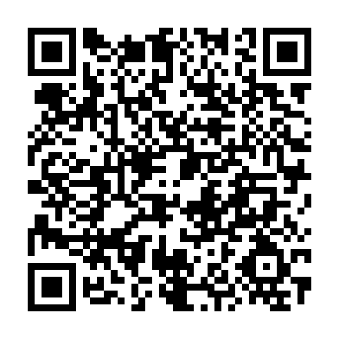

# Support Chat Agent Harness / 赞助支持

Thank you for supporting the open-source development, testing, maintenance and documentation of **Chat Agent Harness (CAH)**.

感谢你支持 **Chat Agent Harness (CAH)** 的开源开发、测试、维护和文档工作。所有赞助均为自愿支持，不构成购买服务或获得功能交付的承诺。

## International / 国际渠道

- [Ko-fi — kou392350](https://ko-fi.com/kou392350)
- [Patreon — Kou848](https://www.patreon.com/cw/Kou848)

## Alipay / 支付宝

Use the Alipay app to scan the QR code below. / 请使用支付宝「扫一扫」扫描下方收款码。

  

**收款昵称 / Recipient:** `(**天)`

This QR code was faithfully reconstructed from the QR content in the recipient's supplied Alipay image and scan-verified against the original. The avatar/background from the screenshot were intentionally omitted for a clean, readable code. / 此二维码由提供的支付宝图片提取并经扫码内容一致性验证；为保证清晰度，未包含原截图背景及头像。

Payments are processed by the respective platforms or Alipay, not by GitHub. / 支付处理由相应平台或支付宝完成，GitHub 本身不处理支付宝付款。

---

**Thank you! / 感谢支持！**
